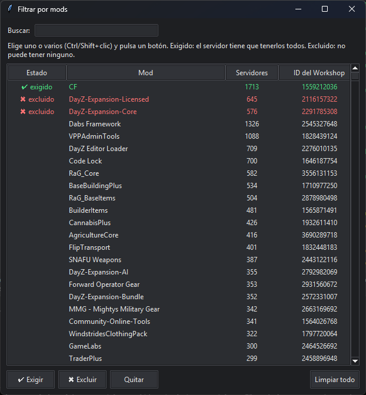
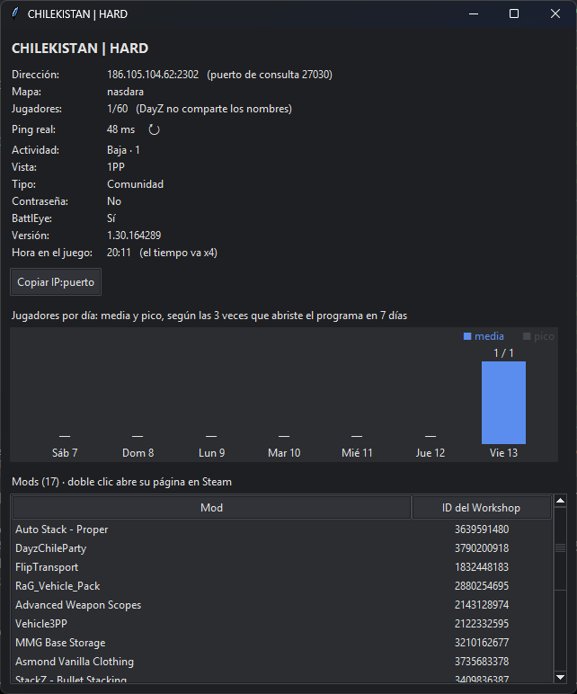
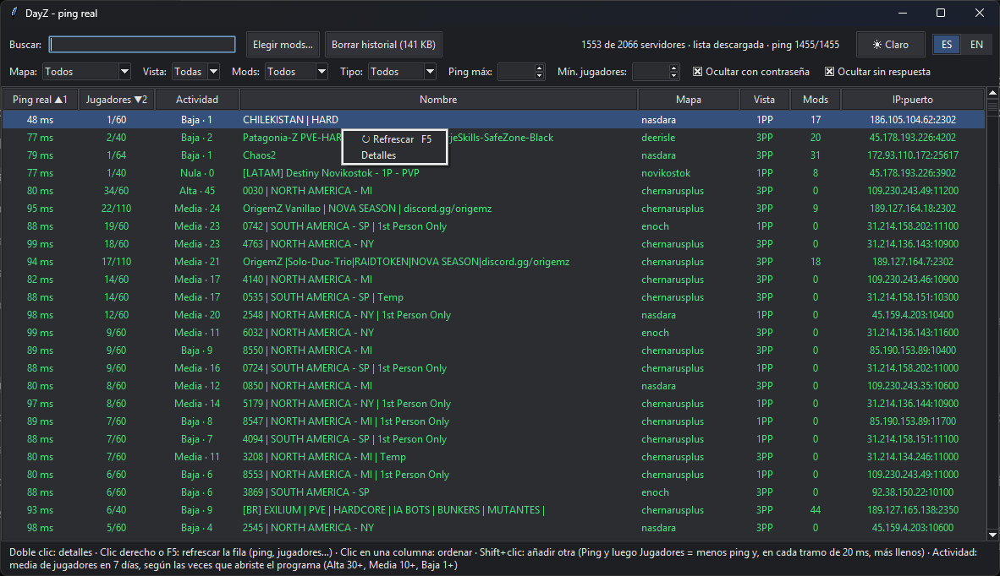
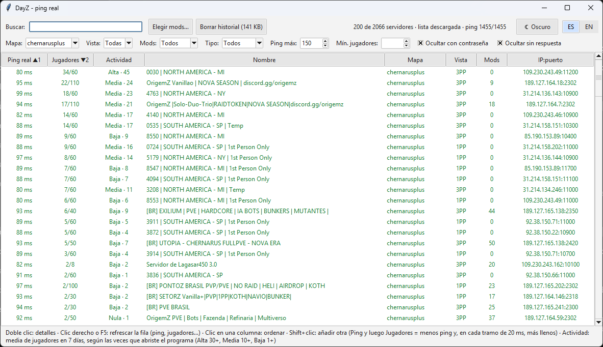
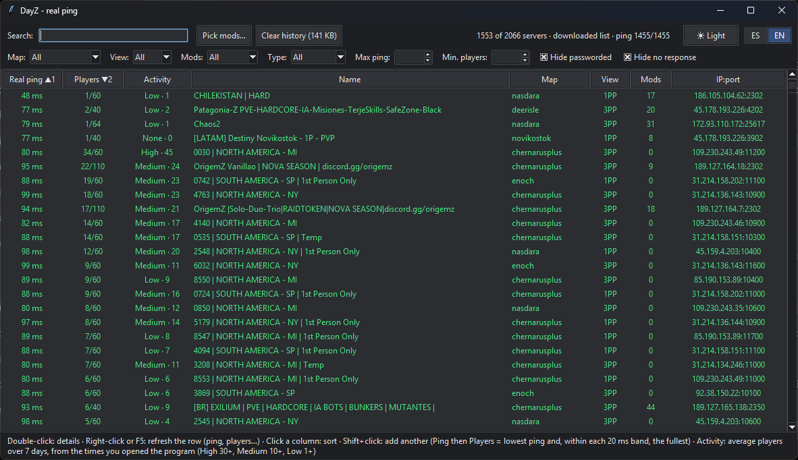
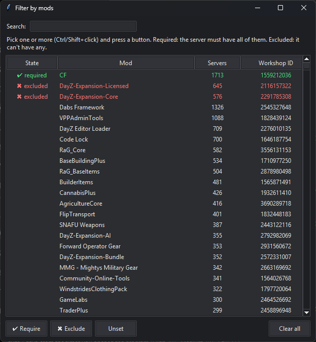
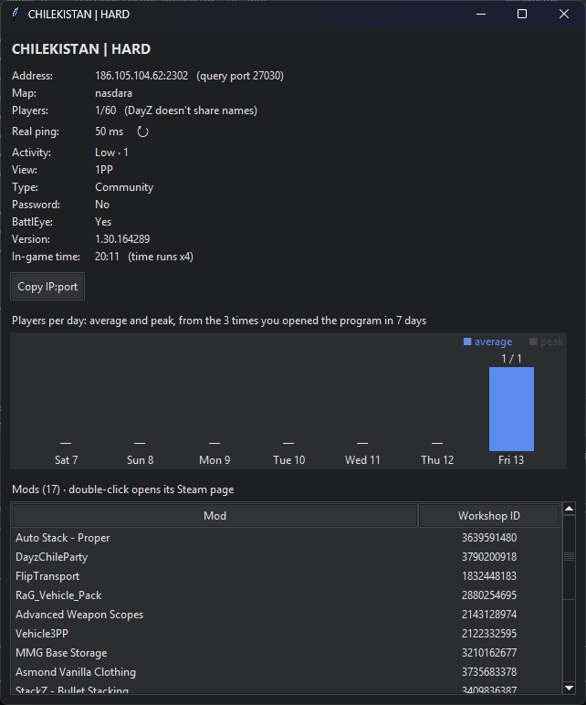
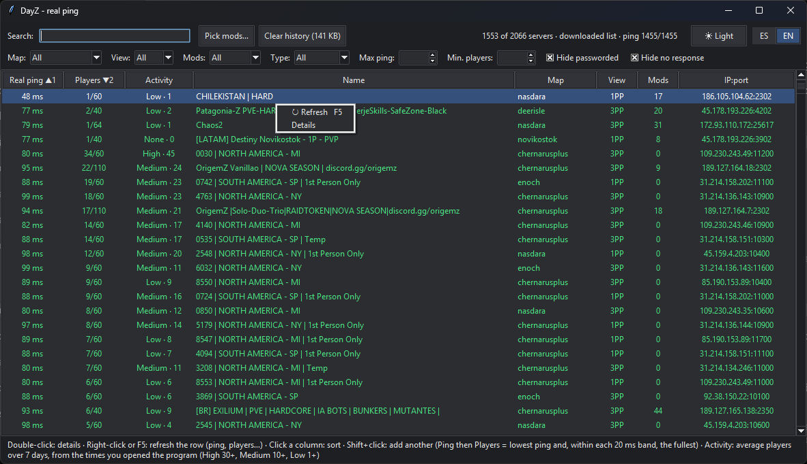
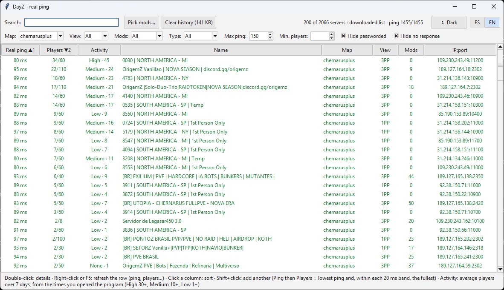

# dayz-real-ping-browser

**Explorador de servidores de DayZ con el ping real** · **DayZ server browser with the real ping**

[Español](#español) · [English](#english)

---

## Español

### ¿Qué es y por qué?

El ping que muestra **DZSA Launcher** (y el navegador del propio DayZ) a veces **no es real**. Se mide con la consulta de la lista de servidores, y muchos servidores con protección anti-DDoS la responden desde un punto cercano a ti, no desde donde está el servidor. Por eso puedes ver **80 ms en el launcher y 220 ms en el juego**.

Este programa toma la lista de servidores de DZSA y mide el **ping real** (ICMP) desde tu PC hasta cada servidor, el mismo que verás dentro del juego. Además permite filtrar, ordenar, elegir por mods y ver la actividad de cada servidor.

### Requisitos

| | |
|---|---|
| **Sistema** | Windows 10 u 11 (usa funciones de red y de ventanas propias de Windows). |
| **Python** | 3.8 o superior, con **tkinter** (probado con Python 3.13). El instalador de [python.org](https://www.python.org/downloads/) lo incluye: deja marcada la opción *tcl/tk and IDLE*. No hace falta instalar nada con `pip`. |
| **DZSA Launcher** | Recomendado ([dayzsalauncher.com](https://dayzsalauncher.com)). El programa usa la lista que el launcher guarda en tu PC (más rápido) y, si no la encuentra o tiene más de 30 minutos, la descarga de la API pública de DZSA (~2,4 MB). **Para entrar a un servidor sigues usando DZSA Launcher**: este programa no abre el juego. |
| **DayZ** | En Steam, para jugar. |
| **Internet** | Para descargar la lista, medir el ping y refrescar servidores. |
| **Permisos** | No necesita administrador. La carpeta del programa debe permitir escribir (guarda ahí tus ajustes y el historial), así que **no lo pongas en *Archivos de programa***. |

### Instalación

1. Instala Python desde [python.org](https://www.python.org/downloads/) si no lo tienes (deja marcadas las opciones por defecto).
2. Descarga este repositorio: botón verde **Code → Download ZIP** y descomprímelo, por ejemplo en `Documentos\dayz-real-ping-browser`.
   O con git: `git clone https://github.com/pepperoniego1247/dayz-real-ping-browser.git`
3. Haz doble clic en **`dayz_ping.pyw`**. Se abre sin ventana de consola.
4. Opcional: para tenerlo a mano, clic derecho en `dayz_ping.pyw` → *Mostrar más opciones* → *Enviar a* → *Escritorio (crear acceso directo)*.

Para comprobar que todo funciona en tu PC, abre una terminal en la carpeta y ejecuta `python dayz_ping.pyw --selftest`. Debe terminar con `ok ... servidores`.

### Apartados y cómo funcionan

#### Lista con el ping real

Al abrirse, carga la lista y mide el ping de los servidores **con al menos un jugador** (unos 2.000), empezando por los más llenos. Tarda unos 30 segundos; la barra de arriba muestra el progreso (`ping 850/1500`). El ping sale en color: **verde** < 100 ms, **amarillo** 100-169 ms, **rojo** 170 ms o más.

- Mide 16 servidores a la vez: con más, muchas conexiones domésticas pierden respuestas y el resultado sería peor.
- Alrededor del **20 % de los servidores bloquea el ping real**. Para esos se muestra el **ping del launcher**, en gris y con **≈** delante (por ejemplo `≈ 85 ms`): es la misma medición que hace DZSA Launcher y **puede ser menor que el real**. Solo los que no responden a ninguna de las dos mediciones aparecen como *sin resp.* (por defecto se ocultan con *Ocultar sin respuesta*).

#### Filtros

- **Buscar**: por nombre o mapa.
- **Mapa**, **Vista** (1PP / 3PP), **Mods** (con o sin mods), **Tipo** (oficiales o de comunidad).
- **Ping máx** y **Mín. jugadores**.
- **Ocultar con contraseña** y **Ocultar sin respuesta** (las dos vienen marcadas).

#### Ordenar por varias columnas

- **Clic** en una cabecera ordena por esa columna; otro clic invierte el orden.
- **Shift+clic** añade otra columna como siguiente criterio. Las cabeceras se numeran: `Ping real ▲1 · Jugadores ▼2`.
- Con *Ping y luego Jugadores*, el ping se agrupa en tramos de 20 ms y dentro de cada tramo salen primero los más llenos: así encuentras servidores **con poco ping y mucha gente**.

#### Elegir mods

El botón **Elegir mods…** lista todos los mods distintos que usan los servidores (unos 7.000), con en cuántos servidores está cada uno y un buscador. Selecciona uno o varios (Ctrl/Shift+clic) y pulsa:

- **✔ Exigir**: el servidor tiene que tener todos los exigidos.
- **✖ Excluir**: el servidor no puede tener ninguno (útil para evitar mods que no te gustan).

Los mods se identifican por su ID del Workshop, porque el mismo mod a veces aparece con nombres distintos en cada servidor.

#### Detalles de un servidor

**Doble clic** en un servidor (o Enter) abre sus detalles: dirección, mapa, jugadores, ping real, actividad, vista, tipo, contraseña, BattlEye, versión y hora del juego, su lista de mods (doble clic en un mod abre su página en Steam), el botón **Copiar IP:puerto** y la gráfica de jugadores por día.

- El icono **↻** junto al ping vuelve a pedir los datos del servidor (jugadores, hora, mods…) y mide su ping otra vez.
- DayZ **no comparte los nombres de los jugadores**, así que solo se puede mostrar cuántos hay.

#### Refrescar un servidor

**Clic derecho** en una fila → **↻ Refrescar**, o selecciona una o varias filas y pulsa **F5**. Pide a DZSA los datos de ese servidor (menos de 1 KB) y mide su ping, sin descargar la lista entera.

#### Actividad semanal e historial

La columna **Actividad** indica la media de jugadores de los últimos 7 días: **Alta** (30 o más), **Media** (10 o más), **Baja** (1 o más) o **Nula**. Los detalles muestran una gráfica con la media y el pico de cada día.

No hay ninguna fuente gratuita con el historial de los servidores de DayZ, así que el programa **lo construye él mismo**:

- Cada vez que lo abres guarda cuántos jugadores tiene cada servidor (unos 50 KB). **No se queda nada funcionando en segundo plano.**
- Hacen falta **3 aperturas** (separadas al menos 20 minutos) para que la columna muestre algo; antes sale `—`.
- Se guardan solo los últimos 8 días (unos pocos MB como mucho).
- Los datos tienen los huecos de cuando no lo abres: si lo abres siempre a la misma hora, la media refleja esa hora.
- El botón **Borrar historial (tamaño)** lo elimina, con confirmación.

#### Tema e idioma

- **☀ Claro / ☾ Oscuro**: empieza con el tema de Windows.
- **ES | EN**: empieza en español.
- Las dos elecciones se recuerdan. Si cambias el tema o el idioma con ventanas de detalles o el selector de mods abiertos, se actualizan solas sin perder lo que tenían.

### Consideraciones

- **El ping real también puede engañar a veces**: algún servidor con protección podría responder al ping desde un punto cercano. Si un servidor parece demasiado bueno, compáralo con el ping dentro del juego.
- Solo se muestran servidores con al menos un jugador.
- Los datos vienen de la API pública de DZSA Launcher, que no es oficial ni está documentada: si cambia, el programa podría dejar de cargar la lista.
- **Uso responsable de la API de DZSA**: el programa usa primero la lista que ya guardó DZSA Launcher y solo descarga una nueva si tiene más de 30 minutos (comprimida, ~2,4 MB). Consulta servidores sueltos solo cuando lo pides (detalles, ↻, F5), con un máximo de 4 a la vez, y se identifica con su nombre y el enlace a este repositorio. Si eres de DZSA y quieres que algo cambie, abre un *issue*.
- Al cerrar la ventana el programa termina por completo.

### Archivos que crea

En la misma carpeta que `dayz_ping.pyw`:

- `settings.json`: idioma y tema elegidos.
- `history.json`: el historial de jugadores (bórralo con el botón *Borrar historial* o eliminando el archivo).

### Privacidad

El programa solo se conecta a `dayzsalauncher.com` (lista y datos de servidores) y envía pings a los servidores de DayZ. No envía datos tuyos a ningún sitio; todo se guarda en tu PC.

### Problemas comunes

- **No se abre al hacer doble clic**: instala Python desde python.org con las opciones por defecto, o abre una terminal en la carpeta y ejecuta `python dayz_ping.pyw` para ver el error.
- **`No module named tkinter`**: reinstala Python y marca *tcl/tk and IDLE*.
- **Aparece `Error:` arriba**: no hay internet y tampoco está la lista de DZSA Launcher. Abre DZSA Launcher una vez o revisa tu conexión.
- **Muchos `≈` o *sin resp.***: es normal en un 20 % de servidores; si son casi todos, puede que un firewall o antivirus bloquee el ping (ICMP).

### Licencia

[MIT](LICENSE). Proyecto independiente, sin relación con DZSA Launcher ni con Bohemia Interactive. DayZ es una marca de Bohemia Interactive.

---

## English

### What is it and why?

The ping shown by **DZSA Launcher** (and DayZ's own server browser) is sometimes **not real**. It is measured with the server-list query, and many servers behind DDoS protection answer that query from a point close to you instead of from the server itself. That is how you get **80 ms in the launcher and 220 ms in game**.

This program takes the DZSA server list and measures the **real ping** (ICMP) from your PC to each server, the same one you will see in game. It also lets you filter, sort, pick by mods and see how active each server is.

### Requirements

| | |
|---|---|
| **System** | Windows 10 or 11 (it uses Windows-specific networking and window functions). |
| **Python** | 3.8 or newer, with **tkinter** (tested with Python 3.13). The [python.org](https://www.python.org/downloads/) installer includes it: keep *tcl/tk and IDLE* checked. Nothing to install with `pip`. |
| **DZSA Launcher** | Recommended ([dayzsalauncher.com](https://dayzsalauncher.com)). The program uses the list the launcher saves on your PC (faster) and, if it is missing or older than 30 minutes, downloads it from DZSA's public API (~2.4 MB). **You still join servers with DZSA Launcher**: this program does not start the game. |
| **DayZ** | On Steam, to play. |
| **Internet** | To download the list, measure ping and refresh servers. |
| **Permissions** | No administrator needed. The program folder must be writable (it stores your settings and history there), so **don't put it in *Program Files***. |

### Installation

1. Install Python from [python.org](https://www.python.org/downloads/) if you don't have it (keep the default options).
2. Download this repository: green **Code → Download ZIP** button and unzip it, for example into `Documents\dayz-real-ping-browser`.
   Or with git: `git clone https://github.com/pepperoniego1247/dayz-real-ping-browser.git`
3. Double-click **`dayz_ping.pyw`**. It opens without a console window.
4. Optional: right-click `dayz_ping.pyw` → *Show more options* → *Send to* → *Desktop (create shortcut)*.

To check that everything works on your PC, open a terminal in the folder and run `python dayz_ping.pyw --selftest`. It should end with `ok ... servidores`.

### Features and how they work

#### List with the real ping

On start it loads the list and measures the ping of the servers **with at least one player** (about 2,000), fullest first. It takes about 30 seconds; the top bar shows progress (`ping 850/1500`). Ping is colored: **green** < 100 ms, **yellow** 100-169 ms, **red** 170 ms or more.

- It pings 16 servers at a time: with more, many home connections drop replies and the results get worse.
- About **20 % of servers block the real ping**. For those, the **launcher ping** is shown in grey with a leading **≈** (for example `≈ 85 ms`): it is the same measurement DZSA Launcher makes and **may be lower than the real one**. Only servers that answer neither measurement show as *no resp.* (hidden by default with *Hide no response*).

#### Filters

- **Search**: by name or map.
- **Map**, **View** (1PP / 3PP), **Mods** (modded or not), **Type** (official or community).
- **Max ping** and **Min. players**.
- **Hide passworded** and **Hide no response** (both on by default).

#### Sorting by several columns

- **Click** a header to sort by it; click again to reverse.
- **Shift+click** adds another column as the next criterion. Headers get numbered: `Real ping ▲1 · Players ▼2`.
- With *Ping then Players*, ping is grouped in 20 ms bands and the fullest servers come first within each band: that is how you find servers **with low ping and lots of people**.

#### Picking mods

The **Pick mods…** button lists every distinct mod used by the servers (about 7,000), with how many servers use each one and a search box. Select one or more (Ctrl/Shift+click) and press:

- **✔ Require**: the server must have all required mods.
- **✖ Exclude**: the server can't have any of them (handy to avoid mods you don't like).

Mods are identified by their Workshop ID, because the same mod sometimes shows up with slightly different names on each server.

#### Server details

**Double-click** a server (or press Enter) to open its details: address, map, players, real ping, activity, view, type, password, BattlEye, version and in-game time, its mod list (double-click a mod to open its Steam page), a **Copy IP:port** button and a players-per-day chart.

- The **↻** icon next to the ping fetches the server's data again (players, time, mods…) and re-measures its ping.
- DayZ **doesn't share player names**, so only the player count can be shown.

#### Refreshing one server

**Right-click** a row → **↻ Refresh**, or select one or more rows and press **F5**. It asks DZSA for that server's data (under 1 KB) and measures its ping, without downloading the whole list.

#### Weekly activity and history

The **Activity** column shows the average players over the last 7 days: **High** (30+), **Medium** (10+), **Low** (1+) or **None**. The details window shows a chart with each day's average and peak.

There is no free source of DayZ server history, so the program **builds its own**:

- Each time you open it, it saves how many players each server has (about 50 KB). **Nothing keeps running in the background.**
- It needs **3 openings** (at least 20 minutes apart) before the column shows anything; until then it shows `—`.
- Only the last 8 days are kept (a few MB at most).
- The data has gaps whenever you don't open it: if you always open it at the same hour, the average reflects that hour.
- The **Clear history (size)** button deletes it, after asking for confirmation.

#### Theme and language

- **☀ Light / ☾ Dark**: starts with your Windows theme.
- **ES | EN**: starts in Spanish.
- Both choices are remembered. If you change theme or language while detail windows or the mod picker are open, they update by themselves without losing their state.

### Things to keep in mind

- **The real ping can occasionally mislead too**: a protected server might answer ping from a nearby point. If a server looks too good, compare it with the in-game ping.
- Only servers with at least one player are shown.
- The data comes from DZSA Launcher's public API, which is neither official nor documented: if it changes, the program might stop loading the list.
- **Responsible use of DZSA's API**: the program first uses the list DZSA Launcher already saved and only downloads a new one if it is older than 30 minutes (compressed, ~2.4 MB). It queries single servers only when you ask (details, ↻, F5), at most 4 at a time, and identifies itself with its name and a link to this repository. If you're from DZSA and want something changed, please open an issue.
- Closing the window ends the program completely.

### Files it creates

In the same folder as `dayz_ping.pyw`:

- `settings.json`: chosen language and theme.
- `history.json`: the player history (delete it with *Clear history* or by removing the file).

### Privacy

The program only connects to `dayzsalauncher.com` (server list and server data) and sends pings to DayZ servers. It doesn't send any of your data anywhere; everything stays on your PC.

### Troubleshooting

- **Nothing happens on double-click**: install Python from python.org with the default options, or open a terminal in the folder and run `python dayz_ping.pyw` to see the error.
- **`No module named tkinter`**: reinstall Python and check *tcl/tk and IDLE*.
- **`Error:` at the top**: no internet and no DZSA Launcher list either. Open DZSA Launcher once or check your connection.
- **Lots of `≈` or *no resp.***: normal for about 20 % of servers; if it's nearly all of them, a firewall or antivirus may be blocking ping (ICMP).

### License

[MIT](LICENSE). Independent project, not affiliated with DZSA Launcher or Bohemia Interactive. DayZ is a trademark of Bohemia Interactive.
